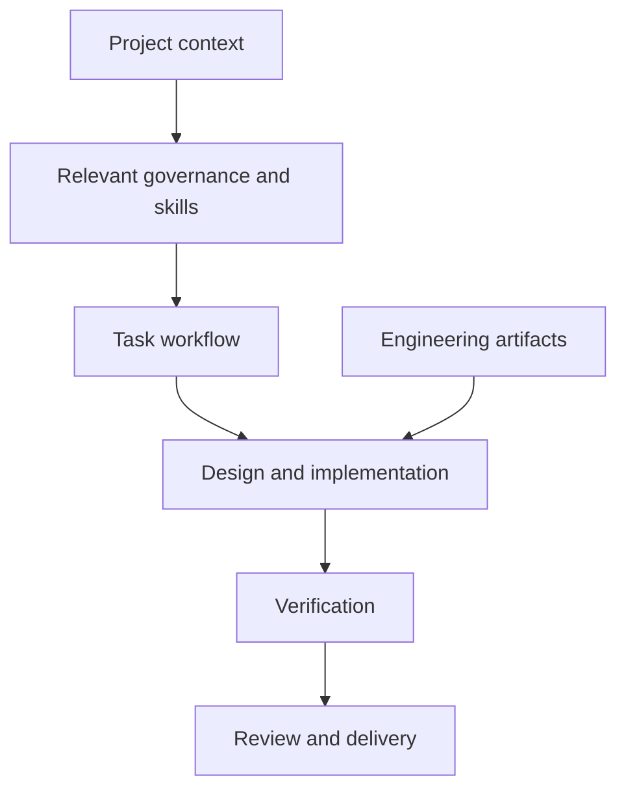

# Agents 4.2.8 — Structured AI-Assisted Project Work — Architecture

The framework gives a project a consistent way to connect requirements, design decisions, implementation checks and delivery. It separates shared rules from task-specific guidance and provides a structure for understanding what is being done, which constraints apply and what has been verified.

## Components

| Component | Responsibility |
|---|---|
| Governance | Shared boundaries and permissions for project activity. |
| Workflow | Coordination of preparation, implementation, review and delivery. |
| Skills | Domain-focused guidance for backend, frontend, data, deployment and related work. |
| Templates | Reusable structures for decisions, issues and project records. |
| Examples | Illustrations of engineering artifacts and their relationships. |
| Scripts | Validation and integration tooling around the file-based framework. |

## Main interactions

## Responsibility boundaries

- Keep guidance in inspectable files. Developers can review and version the framework beside their projects.
- Separate general rules from domain guidance. A task can use the relevant technical material without loading every instruction.
- Separate implementation from delivery. A tested change can be reviewed before it affects a running environment.

## Constraints

The framework organizes work; it does not replace engineering judgment, user decisions or evidence from the target environment.

## Technology

Markdown, structured JSON documents, Python validation scripts and JavaScript integration tooling.
